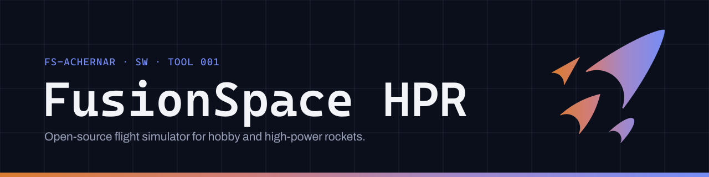

<picture><source media="(prefers-color-scheme: dark)" srcset=".github/brand/readme-banner-dark.png 1x, .github/brand/readme-banner-dark@2x.png 2x"><source media="(prefers-color-scheme: light)" srcset=".github/brand/readme-banner-light.png 1x, .github/brand/readme-banner-light@2x.png 2x"></picture>

# FusionSpace HPR
[](docs/accuracy.md#the-census) [](docs/accuracy.md#real-flights)

[FusionSpace HPR · Sim](https://hpr.fusionspace.co/) (called hpr-sim before release 0.1) flies a
hobby or high-power rocket from the rail to the ground. It tells you how far to trust the numbers
it gives. It's written in Rust, and you can use it from the command line, from Python or as a
library. It's open source and works offline, and I built it to fit inside other projects. It's
checked against independent simulators and real flights, and the results are published, misses
included.

**Status: RELEASED.** Version 0.1.0, the first release, came out on October 8, 2026, and I'm
working toward 0.2 here. The documentation is at <https://hpr.fusionspace.co/>: a searchable
guide, with the API reference (rustdoc) beside it.

## What works today

This is what `main` does, and [the changelog](CHANGELOG.md) says what release 0.1.0 holds. Every
model cites its source and has tests.
[Start here](docs/start-here.md#what-works-today) lists each part with its page.

- It flies a rocket in six degrees of freedom (6-DOF), three of position and three of rotation,
  with its mass changing in flight. The aerodynamics run from subsonic to supersonic. The air is
  the standard atmosphere or a measured one, with winds that change with height. It covers
  staging, clusters and air starts, and recovery with drift.
- You build a rocket part by part, with OpenRocket's catalog of 3,449 makers' parts built in, or
  read it from a design file.
- It reads OpenRocket `.ork` designs whole and writes them back, and it has an open design format
  of its own (`.hpr`, `.hprz`). Motors come as `.eng` and `.rse` files: ThrustCurve.org's
  1,004 solid motors are bundled, and a newer one is fetched from there once.
- Online data is optional: weather (Open-Meteo's forecasts, weather-balloon soundings and NOAA's
  GFS and RAP), [a site's elevation](https://hpr.fusionspace.co/elevation.html) and
  [live motor stock and prices](https://hpr.fusionspace.co/motor-stock.html). The elevation is
  Open-Meteo's, or from a GeoTIFF terrain file of your own. Stock and prices come from
  [motor.fusionspace.co](https://motor.fusionspace.co), matched to ThrustCurve.org's thrust
  curves. Everything else works offline on macOS, Windows and Linux.
- The library runs [Monte Carlo dispersion](https://hpr.fusionspace.co/monte-carlo.html), seeded
  and reproducible, and [sensitivity analysis](https://hpr.fusionspace.co/sensitivity.html) by
  Morris screening and Sobol' indices. It also does
  [optimization](https://hpr.fusionspace.co/optimization.html) of design numbers and choices:
  CMA-ES, NSGA-II's trade-offs between goals, and EGO for slow models. `hpr mc` runs the Monte
  Carlo from the command line.
- `hpr analyze` reads a flight log on its own, with no design file. It uses the format's own reader,
  or a mapping or layout you write. From any logger's barometric altitude or pressure, it takes the
  liftoff, apogee, top speed and landing. Each one comes within a bound held on synthetic flights, or it's withheld
  with the reason.
- It exports flights as `.csv`, `.json`, `.parquet`, `.geojson` or `.kml`, and there's a Python
  package.

**How far to trust it:** every figure is an estimate from a model, not a measurement, and never a
go/no-go verdict. Against 53 logged flights of fliers' own designs, the simulated apogee missed by
12.95% on average (mean absolute), outside the 5% target. On average it read high, by 8.73%. It
can err either way: from about Mach 0.8 the drag reads high, so a fast rocket's apogee reads low.
Plan a waiver or a field's ceiling with room above the simulated apogee
([Accuracy at a glance](#accuracy-at-a-glance) below). The motor's printed data and your range
safety officer (RSO) are authoritative.

The 53 flights' weather is ERA5, generated using Copernicus Climate Change Service information
2026, and contains modified Copernicus Climate Change Service information 2026; neither the
European Commission nor ECMWF is responsible for any use made of it.

## What doesn't work yet

- Comparing a flight log with its simulation, or diagnosing what went wrong in a flight:
  `hpr compare` and `hpr diagnose` refuse for now. Searching a design from the command line
  (`hpr optimize`) refuses too.
- RockSim, RASAero and RocketPy files; C and WebAssembly interfaces; a desktop, web or mobile app
  with 3D flight replay.
- Motors other than commercial solid ones: no hybrids, liquids or research motors before
  release 1.0.
- Effects a flight leaves out: gusts, the rocket pitching as it leaves the rail, a motor's thrust
  off its axis, and a parachute's opening shock. A turbulence model exists, but no flight uses it.
- Accuracy: simulated apogees miss real flights' logged ones by more than the target (above).
  Drag past Mach 1 is lightly checked, and only small angles of attack are modeled.
  [Start here](docs/start-here.md#what-doesnt-work-yet) lists the gaps you're most likely to meet,
  and [the roadmap](docs/ROADMAP.md) the order of the work.

## Accuracy at a glance

Here's what HPR Sim has been compared with, and how it came out. A "code-to-code" line says how
closely HPR Sim agrees with another simulator, not which of the two is right. Only the real
flights are measurements, and on those HPR Sim misses its target. Each number behind this table is
also a check. CI fails when one moves, better or worse, until the change is accepted with a
written reason. CI flies the RocketPy comparisons again on every change. The OpenRocket and
real-flight ones need files CI doesn't have, so it holds their committed numbers
([the census](docs/accuracy.md#the-census)).

<!-- census: written by `cargo xtask census --accept` from validation/reports/census.json; do not edit -->

| compared with | kind | held to | flights (speed) | result |
|---|---|---|---|---|
| [RocketPy 1.13.0](https://github.com/nrdptel/fusionspace-eridanus/blob/main/validation/reports/census.md): descents under a parachute | code-to-code, same inputs | gate: each metric's tolerance, 0.2% to 3% | 5 descents | 30 of 30 gated metrics pass |
| [RocketPy 1.13.0, patched](https://github.com/nrdptel/fusionspace-eridanus/blob/main/validation/reports/census.md): whole flights on the same drag | code-to-code, same inputs | gate: each metric's tolerance, 0.2% to 3% | 9 flights (8 subsonic, 1 transonic) | 142 of 142 gated metrics pass; apogee +0.04% to +1.21%; 11 not scored, each for a written reason |
| [RocketPy 1.13.0, patched](https://github.com/nrdptel/fusionspace-eridanus/blob/main/validation/reports/census.md): whole flights, each code on its own drag | code-to-code, each code's own drag | target: 3% on each metric, reported, not enforced | 6 flights (5 subsonic, 1 transonic) | 75 of 102 metrics within target; apogee −7.28% to +10.30% |
| [OpenRocket 24.12](https://github.com/nrdptel/fusionspace-eridanus/blob/main/validation/reports/census.md): calm flights of OpenRocket's examples | code-to-code, each code's own model | no target; an apogee more than 5% off needs a written cause | 54 flights (53 subsonic, 1 transonic); 3 more not flown | apogee −37.93% to +13.80%; apogee within 5% on 45 of 53, largest speed within 5% on 50 of 53, margin within 0.2&nbsp;calibers on 52 of 53, launch mass within 1% on 54 of 54, mass at rod clearance within 1% on 50 of 54, center of mass at rod clearance within 0.2&nbsp;calibers on 54 of 54; 3 values withheld by the report |
| [OpenRocket 24.12](https://github.com/nrdptel/fusionspace-eridanus/blob/main/validation/reports/census.md): calm flights of the private designs | code-to-code, each code's own model | no target; an apogee more than 5% off needs a written cause | 35 flights (28 subsonic, 6 transonic, 1 supersonic); 2 more not flown | apogee −4.84% to +13.60%; apogee within 5% on 34 of 35, largest speed within 5% on 34 of 35, margin within 0.2&nbsp;calibers on 35 of 35, launch mass within 1% on 35 of 35, mass at rod clearance within 1% on 35 of 35, center of mass at rod clearance within 0.2&nbsp;calibers on 35 of 35 |
| [the teams' altimeter logs](https://github.com/nrdptel/fusionspace-eridanus/blob/main/validation/reports/census.md): real flights | measured | target: mean absolute apogee error 5% | 7 flights (3 subsonic, 4 transonic) | mean absolute apogee error 6.06% (target 5%, missed); apogee −8.90% to +10.40%; apogee within 5% on 2 of 7, climb's RMS height error within 3% of apogee on 2 of 7 |

<!-- census: end -->

The census doesn't count 53 more real flights, from a private collection. On those, HPR Sim's
apogees are +8.73% above their logs on average and OpenRocket's +7.79%, both outside the 5% target
([private collection](docs/accuracy.md#real-flights-of-the-private-collection)).

"Patched" means RocketPy 1.13.0 run with two fixes from RocketPy's own pull requests, which
correct the point it takes the burn's turning moments about
([why](docs/accuracy.md#whole-flights-against-rocketpy)).

## Install and first flight

Release 0.1.0 is out, four ways:

- **The command line:** download the `fusionspace-hpr` archive for your system from
  [the releases page](https://github.com/nrdptel/fusionspace-eridanus/releases), or run
  `cargo install fusionspace-hpr-cli --locked`. Either one gives you the `hpr` command.
- **The command line from a package manager:** `brew install nrdptel/tap/fusionspace-hpr` with
  Homebrew, or Scoop on Windows
  ([Install a release](https://hpr.fusionspace.co/getting-started.html#install-a-release)).
- **Python:** `pip install fusionspace-hpr`, then `from fusionspace import hpr`.
- **A Rust program:** `cargo add fusionspace-hpr`, then `use hpr::…`.

[Install a release](https://hpr.fusionspace.co/getting-started.html#install-a-release) has
the details, and [the changelog](https://github.com/nrdptel/fusionspace-eridanus/blob/main/CHANGELOG.md) says
what 0.1.0 does, how far to trust it, and its known gaps.

To build it yourself instead, clone this repository. You need [Git](https://git-scm.com) and
[rustup](https://rustup.rs), Rust's installer. The first build fetches the pinned Rust version and
takes a few minutes.
[Getting started](https://hpr.fusionspace.co/getting-started.html#what-you-need) lists what
each operating system needs.

```bash
git clone https://github.com/nrdptel/fusionspace-eridanus
cd fusionspace-eridanus
cargo install --path crates/hpr-cli --locked
```

That puts `hpr` on your path. Fly the how-to guides' rocket, an OpenRocket design saved with an
AeroTech H170M:

<!-- cli: example `hpr sim validation/fixtures/ork/guides/level-1.ork`; written by `cargo xtask cli`; do not edit -->

```text
$ hpr sim validation/fixtures/ork/guides/level-1.ork
Level 1 guide rocket (level-1.ork)
configuration 1 of 2: [H170M-10]
help: --config flies the others, by number or name: 2 [I175WS-9]
a simulated flight, not a measurement

static margin         1.70 calibers off the rail; least 1.70 calibers, at 0.12 s, before apogee
CG and CP             0.811 m (31.9 in) and 0.923 m (36.3 in) aft of the nose tip, off the rail
apogee                1065.1 m (3494 ft) above the site at 11.62 s
rail exit speed       26.3 m/s (86 ft/s)
delay                 apogee 9.48 s after burnout; the motor's set delay: 10 s; its charge fires 0.52 s after apogee
descent               4.4 m/s (15 ft/s) at landing under `Parachute`

motor: 1 × H170M (from the bundled catalog, as of 2026-10-28) in `Motor mount tube`, lit at launch
recovery: `Parachute` at the ejection charge, 0.520 m² of drag area, opened at 12.14 s
launched at 0.00000° N, 0.00000° E, 0 m (0 ft) above sea level, from a 1.5 m (4.9 ft) vertical rail, in calm air
note: the file's 1 recovery device flies as OpenRocket flies it. Each opens fully at its event, with the file's drag coefficient or OpenRocket's own. Once one opens, the rocket descends as a point under the open devices' drag alone
warning: drag: issue #67: a cone-like nose's or shoulder's pressure drag reads high from Mach 0.8 (about twice a measured cone's at Mach 0.85, still +15% at 1.5). So the apogee, the top speed and the drift read low. The flutter margin and the largest dynamic pressure then look better than they are. This flight reaches Mach 0.84 at 1.7 s (https://github.com/nrdptel/fusionspace-eridanus/issues/67)
warning: drag: issue #68: base drag reads high from Mach 0.8 to 1.2 (0.225 against a measured 0.156 at Mach 0.9). So the apogee, the top speed and the drift read low. The flutter margin and the largest dynamic pressure then look better than they are. This flight reaches Mach 0.84 at 1.7 s (https://github.com/nrdptel/fusionspace-eridanus/issues/68)
warning: drag: issue #18: skin friction is taken as fully turbulent, but on a smooth surface the flow stays laminar near the nose, where friction is lower. HPR Sim's drag reads high by 3.6% on RocketPy's Calisto at Mach 0.3. If this surface is that smooth, the apogee, the top speed and the drift read low. The flutter margin and the largest dynamic pressure then look better than they are (https://github.com/nrdptel/fusionspace-eridanus/issues/18)
warning: stability: issue #172: the static margin read up to 0.1108 calibers higher than OpenRocket's on four private designs, for a reason not yet found. This flight's margin may read high by as much (https://github.com/nrdptel/fusionspace-eridanus/issues/172)

event                   time                 height                    speed
liftoff               0.00 s      0.4 m      (1 ft)     0.0 m/s     (0 ft/s)
rail exit             0.12 s      1.9 m      (6 ft)    26.3 m/s    (86 ft/s)
burnout               2.14 s    406.4 m   (1333 ft)   240.4 m/s   (789 ft/s)
apogee               11.62 s   1065.1 m   (3494 ft)     0.1 m/s     (0 ft/s)
charge               12.14 s   1063.7 m   (3490 ft)     5.1 m/s    (17 ft/s)
deployment           12.14 s   1063.7 m   (3490 ft)     5.1 m/s    (17 ft/s)
ground hit          245.78 s      0.0 m      (0 ft)     4.4 m/s    (15 ft/s)
(heights are the center of gravity's above the site; speeds are over the ground)

top speed             285.6 m/s (937 ft/s) at 1.73 s
top Mach number       0.842
landing               0.7 m (2 ft) from the pad at 245.78 s, at 4.4 m/s (15 ft/s)

How far to trust it. Simulated from the design file, not measured. Against 53 logged flights of
fliers' own designs, the simulated apogee averaged 8.7% above the logged one. Each logged apogee is
the height climbed in the day's air. The simulated apogee was within 10% on 26 and read low on 13,
by at most 20%. Plan a waiver or a field's ceiling with room above this apogee; the altimeter's
reading is the one to log, and the RSO decides.
More: https://hpr.fusionspace.co/accuracy.html
```

<!-- cli: end -->

The `help:`, `note:` and `warning:` lines go to standard error and the flight alone to standard
output. So `> flight.txt` saves the flight and leaves them on the terminal. Then fly your own:
`hpr sim my-rocket.ork`. A motor HPR Sim doesn't carry is fetched from ThrustCurve.org once, then
flies offline. Three guides go further:
[Fly your .ork](https://hpr.fusionspace.co/fly-your-ork.html),
[Pick a motor](https://hpr.fusionspace.co/pick-a-motor.html) and
[Check stability for a certification flight](https://hpr.fusionspace.co/stability-for-certification.html).

## Python

`crates/hpr-py` builds `hpr`, a Python package over the library's builder. With it you build a
rocket part by part or read a design file, fly it, and get its recording as NumPy arrays.
`pip install fusionspace-hpr` installs it from PyPI, and
[Python](https://hpr.fusionspace.co/python.html) says how to build and use it.

## The command line

`hpr` is the command-line tool, and [The command line](https://hpr.fusionspace.co/cli.html)
shows each command's output. This table is generated from the commands the tool registers, so it
lists only what exists. A "not yet" command refuses, with exit status 3, until the milestone that
builds it.

<!-- cli: commands, written by `cargo xtask cli` from the registered commands; do not edit -->

| command | what it does | reads | prints | status |
|---|---|---|---|---|
| `hpr sim` | Fly a design (.ork, .hpr, .hprz or a rocket's .json) off a rail and print its flight; save its recording with `--export` | `.ork`, `.hpr` or `.hprz`, a rocket's `.json`, a motor from the bundled catalog, `.eng` or `.rse`, or fetched from ThrustCurve.org | text, JSON, a recording as `.csv`, `.json`, `.parquet`, `.geojson` or `.kml` | available ([how to use it](https://hpr.fusionspace.co/cli.html#hpr-sim)) |
| `hpr convert` | Convert a motor file between .eng and .rse, write a catalog motor as either, or convert a design between .ork, .hpr and .hprz | `.eng`, `.rse`, the bundled catalog, a design as `.ork`, `.hpr` or `.hprz` | `.eng` or `.rse`, `.ork`, `.hpr` or `.hprz`, text, JSON | available ([how to use it](https://hpr.fusionspace.co/cli.html#hpr-convert)) |
| `hpr motors` | Look up motors in the bundled catalog, read a .eng or .rse motor file, fetch a curve from ThrustCurve.org, or search vendors' stock and prices | `.eng`, `.rse`, the bundled catalog, motor.fusionspace.co's stock and prices, fetched or saved, ThrustCurve.org's curves, fetched and cached | text, JSON | available ([how to use it](https://hpr.fusionspace.co/cli.html#hpr-motors)) |
| `hpr weather` | Fetch a launch day's weather, or read a weather file, as a profile of air and wind | Open-Meteo, a University of Wyoming sounding, GFS or RAP, fetched or saved, a whole GFS file, an ERA5 `.nc` | text, JSON, a profile as `.json` | available ([how to use it](https://hpr.fusionspace.co/cli.html#hpr-weather)) |
| `hpr mc` | Fly a design many times with its inputs scattered at random, and print how its apogee and landing spread; save every flight with `--export` | what `hpr sim` reads: a design and its motor | text, JSON, every flight's draw and outcome as `.csv` | available ([how to use it](https://hpr.fusionspace.co/cli.html#hpr-mc)) |
| `hpr optimize` | Search a design's parameters for a goal | - | - | not yet: [M6.3](https://hpr.fusionspace.co/decisions-and-roadmap.html#m6-3) |
| `hpr compare` | Compare a flight log with its simulation | - | - | not yet: [M7.3](https://hpr.fusionspace.co/decisions-and-roadmap.html#m7-3) |
| `hpr analyze` | Read a flight log and print its readings, with no design file | a flight log in any layout HPR Sim reads, by its own reader, a workbook's sheet or a raw dump's recording, as chosen, another logger's table by a column mapping, binary records or a console capture by a record layout, a Raven FIP export below no header, by the header stated | text, JSON | available ([how to use it](https://hpr.fusionspace.co/cli.html#hpr-analyze)) |
| `hpr diagnose` | Diagnose what went wrong in a flight from its log | - | - | not yet: [M7.4](https://hpr.fusionspace.co/decisions-and-roadmap.html#m7-4) |
| `hpr completions` | Print a shell completion script for `hpr` | - | a bash, elvish, fish, powershell or zsh script, JSON | available ([how to use it](https://hpr.fusionspace.co/cli.html#hpr-completions)) |

<!-- cli: end -->

## Where the details are

[The documentation site](https://hpr.fusionspace.co/) has every page, and you can search it. The
same pages read here on GitHub:

- [Start here](docs/start-here.md) says what works, what doesn't and how far to trust it.
- [Getting started](docs/getting-started.md) flies a first rocket.
- [Accuracy](docs/accuracy.md) has every validation result.
- Each model's page gives its equations and sources.
- [The changelog](CHANGELOG.md) says what each release changed.

`cargo xtask site` builds the site on your machine.

## Building

The toolchain is pinned in `rust-toolchain.toml`, so [rustup](https://rustup.rs) installs the right
version on first use.

```bash
cargo test --workspace --all-features   # unit tests
cargo xtask wasm-check                  # the pure core builds for wasm32-unknown-unknown
cargo deny check                        # dependency licenses, advisories and sources
cargo xtask site                        # build the documentation site and check its links
```

`cargo test` also runs the design format's generated TypeScript and Python readers. So it needs
Node.js 22.18 or later and Python 3.11 or later on the path
([TypeScript and Python](docs/format/hpr.md#typescript-and-python)).

`cargo xtask site` needs mdBook 0.5: `cargo install mdbook --version 0.5.4 --locked` (the version
CI uses) or `brew install mdbook`. The site is built from `docs/` into `target/site`: open
`target/site/index.html`, or read [`docs/start-here.md`](docs/start-here.md) on GitHub.

Validation work uses a local reference library (other simulators, papers, motor data), pinned in
`validation/refs.lock.toml` and downloaded into the gitignored `refs/`. Fetching it needs `git`,
`curl` and [uv](https://docs.astral.sh/uv/); the OpenRocket oracle also needs Java 17+.

```bash
cargo xtask refs fetch    # fetch everything to its pinned state (safe to rerun)
cargo xtask refs verify   # re-hash everything against the pins
cargo xtask refs doctor   # which tools and oracles work on this machine
```

The workspace's crates live under `crates/`, and `docs/ARCHITECTURE.md` says what each one is for.
[The roadmap](docs/ROADMAP.md) lists the open work and [its archive](docs/roadmap-done.md) what's
done.

## Design

HPR Sim is part of FusionSpace, my family of rocketry tools. It follows FusionSpace's
[product system](https://github.com/nrdptel/fusionspace-design/blob/main/product/README.md): the
rules for how its tools look, word things and show how far to trust a result. The system is pinned
at revision E, its October 14, 2026 commit `1b88597`. It changes how HPR Sim presents numbers, not
how it computes them. [The decision record](docs/decisions/0164-the-fusionspace-product-system.md)
says what's adopted. The product system milestone ([M0.6](docs/decisions-and-roadmap.md#m0-6))
brought the site, the command line, the plot and the exports in line with it.

- The system's [principles](https://github.com/nrdptel/fusionspace-design/blob/main/product/principles.md)
  and [foundations](https://github.com/nrdptel/fusionspace-design/blob/main/product/foundations.md)
  apply to everything. On top of them, the command line follows
  [`cli.md`](https://github.com/nrdptel/fusionspace-design/blob/main/product/cli.md), the
  documentation site [`web.md`](https://github.com/nrdptel/fusionspace-design/blob/main/product/web.md),
  and numbers, plots and exports
  [`data.md`](https://github.com/nrdptel/fusionspace-design/blob/main/product/data.md).
- The site's theme and fonts and the command line's color styles are the system's files, copied in
  unchanged with their license lines ([third-party notices](THIRD-PARTY-NOTICES.md)). The plot,
  the site's figures and the badges above use its
  [`tokens/`](https://github.com/nrdptel/fusionspace-design/blob/main/product/tokens/) colors
  and its fonts, Cascadia Mono and Archivo, and no others. `cargo xtask figures` fails an SVG
  that doesn't ([the rules](docs/writing.md#figures-in-the-systems-colors-and-fonts)).
- The designation `FS-ACHERNAR · SW · TOOL 001` names HPR Sim like a part. Achernar is its
  internal name, one of the stars of project Eridanus, and then come software and tool 1
  ([the decision that named it](docs/decisions/0198-the-2026-10-07-project-eridanus.md)).
  `hpr --version`, the site's title block and every file HPR Sim writes show it beside the version.
  Files stamped with the earlier `FS · SW · TOOL 005` still read.
- Its [`review.md`](https://github.com/nrdptel/fusionspace-design/blob/main/product/review.md) checklist runs before each release.

## License

`FS-ACHERNAR · SW · TOOL 001` · version 0.1.0 · part of [FusionSpace](https://fusionspace.co).
Licensed under either of

- Apache License, Version 2.0 ([LICENSE-APACHE](LICENSE-APACHE))
- MIT license ([LICENSE-MIT](LICENSE-MIT))

at your option. Third-party sources and their licenses are listed in
[THIRD-PARTY-NOTICES.md](THIRD-PARTY-NOTICES.md).

The FusionSpace name, its logo (four nose cones) and the banners in `.github/brand/` are mine, and
these licenses don't cover them (see fusionspace-design's
[`TRADEMARKS.md`](https://github.com/nrdptel/fusionspace-design/blob/main/TRADEMARKS.md)).

Unless you explicitly state otherwise, any contribution intentionally submitted for inclusion in
the work by you, as defined in the Apache-2.0 license, shall be dual licensed as above, without any
additional terms or conditions.
