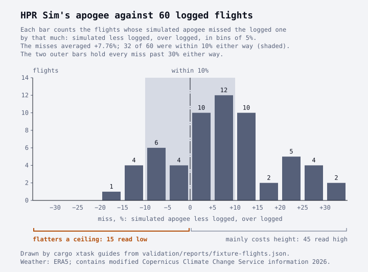

# Trusting a simulation

A simulated apogee is an estimate: this guide shows how far off it has been on real flights, and
which way it errs.

This guide is for a flier who reads a simulated apogee to pick a motor, plan a waiver or a
field's ceiling, or set up a flight. It explains what a simulator can and can't know about a
flight, how big its misses have been, and which miss to plan for. It's the first of the guides in
*Rocketry explained*. They explain the physics behind the numbers HPR Sim prints.

> **How far to trust it.** A test reads every number in this guide's text from a committed report,
> and CI reruns the worked example's command. The reports set HPR Sim's apogees against 53 logged
> flights of fliers' own designs ([report][fixture-report]), and against 7 public flights
> ([report][real-report]). They measure apogee alone: no comparison here checks a top speed, a
> descent or a landing place against a real flight.
>
> The guide gives ranges, not verdicts. The safety code and the range safety officer (the RSO)
> decide whether a rocket flies.

## Two ways a simulation is wrong

A simulation can be wrong in what it's told and in how it works. The first is its inputs. They're
the design file's masses and balance point, the finish of the paint, the motor's real thrust, and
the day's wind and air. The second is its models: above all the drag, which a simulator estimates
from the rocket's shape instead of measuring it.

Scattering the inputs shows the first kind. HPR Sim's Monte Carlo command, `hpr mc`, flies the
rocket many times, each with its inputs drawn afresh, and prints the spread
([Monte Carlo dispersion](monte-carlo.md)). It can't show the second kind: a model that's wrong
the same way on every run moves every run together.

Only flights that really flew show the second kind. The comparisons below fly each rocket's design
in the day's weather and set its apogee against the altimeter's. So they measure both kinds at
once, and the altimeter's own error with them. The weather is the day's, but the masses and the
finish are the design file's, as most fliers' files are. And an altimeter reads the air's
pressure, not the height ([Reading a flight log](reading-a-flight-log.md)).

## How far off it has been

A miss is the simulated apogee less the logged one, as a share of the logged one. A positive miss
means the simulator said higher than the rocket flew:

$$
\text{miss} = \frac{\text{simulated} - \text{logged}}{\text{logged}}
$$

For example, the public flight of Cavour, Politecnico di Torino, EuRoC 2023 read 2,789 m
(9,150 ft) on its altimeter at the top. An altimeter riding HPR Sim's flight of its design would
have read 2,946 m (9,665 ft). The miss is (2,946 − 2,789) / 2,789 = +5.63%
([report][real-report]). EuRoC is the European Rocketry Challenge. On the public flights, both
sides of a miss are altimeter readings.

Across 53 logged flights of fliers' own designs, HPR Sim's apogee averaged +8.73% above the logged
one ([report][fixture-report]). Each flight was flown as drawn in its day's air. Each logged
apogee there is the altimeter's reading turned into the height climbed in that day's air, so the
comparison leans on that conversion too. Without their signs, the misses averaged 12.95%, and 26
were within 10% either way. The figure counts them by size.



The misses lean high: 40 of the 53 simulated apogees are above the logged one. And they spread
wide: the lowest read between 15% and 20% low, the highest past +30% high.

OpenRocket, flying the same files in each day's wind and the pad's air, averaged +7.79% above and
missed by 12.02% without signs ([report][fixture-report]). The two simulators agreed with each
other within 5% on 52 of the 53 flights. So most of the miss is one they share, and where it comes
from isn't pinned down. It could be in what both are given (the design file, the motor's curve,
the logged apogee they're scored against), or in models they have in common. A second simulator
checks how the first is coded, not what the two share.

The 7 public flights are university teams' rockets, flown in a
[reanalysis](glossary.md#reanalysis) of their days' weather, one of them in another year's
([report][real-report]). HPR Sim's apogee missed them by 6.04% on average without signs, from
−8.90% to +10.40% one by one. With signs the misses averaged −0.25%, so on these the highs and
lows nearly cancel. The average without signs is still outside the project's own 5% target
([Accuracy](accuracy.md#real-flights)). The note HPR Sim prints with every apogee quotes the 53,
the larger set and the less flattering one ([the trust note's decision record][adr-211]).

## Which miss flatters

A miss can flatter or warn, and which one depends on the plan. For a waiver or a field's ceiling, a
simulated apogee below the real one flatters: the rocket climbs past the height that was planned
for. A simulated apogee above the real one mainly costs height. For a contest's lowest altitude,
or a motor picked to reach a height, the sides swap, and the high side flatters.

The figure marks the low side, and a test ties the mark to the sign of a miss. The figure's code
marks the bins of negative misses. And
[`a_low_simulated_apogee_is_a_negative_miss`][direction-test] holds that a simulated apogee below
the logged one makes a negative miss in the report's rows. Of the 53 flights, 13 read low, the
lowest of them between 15% and 20% low ([report][fixture-report]). A sample isn't a bound: a
rocket unlike these may miss by more.

One of the public flights shows the low side. An altimeter riding HPR Sim's flight of Juno III,
Projeto Jupiter, Spaceport America Cup 2023 would have read 2,923.4 m (9,591 ft) at the top. The
team's altimeter read 3,151.5 m (10,340 ft), a miss of −7.24% ([report][real-report]). The real
altimeter read 228.1 m (748 ft) higher than the simulated one, and its log ends just short of the
top. The report finds this miss consistent with the motor's impulse, as the example sets it.

So plan a ceiling with room above the simulated apogee. How much room is the flier's and the
RSO's call, and this guide has no number for it.

## The spread from the inputs

The guide's worked example is the small rocket the repository keeps for its how-to guides. It's
flown many times over, with its mass, its drag and its motor's impulse each scattered. The command
gives each scatter as one standard deviation, as a share of the value: `--mass-sd 0.02` for the
mass. The drag's scatter is a guessed spread around HPR Sim's own drag. It widens the runs, but it
can't show a drag that's wrong the same way on every run.

<!-- cli: example `hpr mc validation/fixtures/ork/guides/level-1.ork --runs 200 --seed 2026 --mass-sd 0.02 --drag-sd 0.05 --impulse-sd 0.03` -->

```text
$ hpr mc validation/fixtures/ork/guides/level-1.ork --runs 200 --seed 2026 --mass-sd 0.02 --drag-sd 0.05 --impulse-sd 0.03
Level 1 guide rocket (level-1.ork)
configuration 1 of 2: [H170M-10]
help: --config flies the others, by number or name: 2 [I175WS-9]

200 simulated flights, seed 2026: 0 failed
                        nominal     mean  std dev       5%   median      95%
apogee (m AGL)           1065.1   1072.4     41.5   1006.2   1072.8   1137.3
apogee (ft AGL)            3494     3519      136     3301     3520     3731
landing distance (m)        0.7      0.7      0.0      0.7      0.7      0.8
landing distance (ft)         2        2        0        2        2        3

200 of 200 flights landed, centered 0.7 m (2 ft) west and 0.0 m (0 ft) north of the pad
landing ellipse                   semi-major            semi-minor  heading   flights inside
50%                             0.0 m (0 ft)          0.0 m (0 ft)   090° T            74.5%
95%                             0.1 m (0 ft)          0.0 m (0 ft)   090° T            98.0%
95%, the next flight            0.1 m (0 ft)          0.0 m (0 ft)   090° T            98.5%

motor: 1 × H170M (from the bundled catalog, as of 2026-09-17) in `Motor mount tube`, lit at launch
launched at 0.00000° N, 0.00000° E, 0 m (0 ft) above sea level, from a 1.5 m (4.9 ft) vertical rail, in calm air
scattered, one standard deviation each: --mass-sd 0.02, --drag-sd 0.05, --impulse-sd 0.03
note: the file's 1 recovery device flies as OpenRocket flies it: each opens fully at its event, with the file's drag coefficient or OpenRocket's own, and once one opens the rocket descends as a point under the open devices' drag alone
warning: drag, the nominal flight: issue #67: a cone-like nose's or shoulder's pressure drag reads high from Mach 0.8 (about twice a measured cone's at Mach 0.85, still +15% at 1.5), so the apogee, the top speed and the drift read low, and the flutter margin and the largest dynamic pressure look better than they are; this flight reaches Mach 0.84 at 1.7 s (https://github.com/nrdptel/fusionspace-eridanus/issues/67)
warning: drag, the nominal flight: issue #68: base drag reads high from Mach 0.8 to 1.2 (0.225 against a measured 0.156 at Mach 0.9), so the apogee, the top speed and the drift read low, and the flutter margin and the largest dynamic pressure look better than they are; this flight reaches Mach 0.84 at 1.7 s (https://github.com/nrdptel/fusionspace-eridanus/issues/68)
warning: drag, the nominal flight: issue #18: skin friction is taken as fully turbulent, but on a smooth surface the flow stays laminar near the nose, where friction is lower: HPR Sim's drag reads high by 3.6% on RocketPy's Calisto at Mach 0.3; if this surface is that smooth, the drag reads high, so the apogee, the top speed and the drift read low, and the flutter margin and the largest dynamic pressure look better than they are (https://github.com/nrdptel/fusionspace-eridanus/issues/18)
warning: stability, the nominal flight: issue #172: the static margin read up to 0.1108 calibers higher than OpenRocket's on four private designs, for a reason not yet found, so this flight's margin may read high by as much (https://github.com/nrdptel/fusionspace-eridanus/issues/172)

How far to trust it. Simulated from the design file, not measured; the spread above comes from the
inputs' scatter alone, not from the model's error. Against 53 logged flights of fliers' own designs,
each logged apogee the height climbed in the day's air, the simulated apogee averaged 8.7% above the
logged one; it was within 10% on 26 and read low on 13, by at most 20%. Plan a waiver or a field's
ceiling with room above this apogee; the altimeter's reading is the one to log, and the RSO decides.
More: https://hpr.fusionspace.co/accuracy.html
```

<!-- cli: end -->

Read it in three parts. The table's `5%` and `95%` columns are
[percentiles](glossary.md#percentile): most runs fell between them, a few on either side. The
warnings name the known model gaps that bear on this flight, each with the side it pushes the
numbers to. Here the drag may read high. If it does, the apogee reads low, the side that flatters
a ceiling.

The note at the end is the miss on real flights from the sections above, which the spread leaves
out. The rest is the flight's setup and its landing ([Monte Carlo dispersion](monte-carlo.md)).

The warnings don't settle which way this rocket will miss. They push its apogee low, yet across
the 53 flights the misses leaned high on average. So causes not yet found can outweigh the known
ones. A warning says which way one known gap pushes, not which way the flight will miss.

The spread and the miss don't add as one range. The spread is this rocket's, from inputs the
command was told to scatter. The miss is a record of other rockets, and it already holds their
files' own input errors. Read the spread as how far the flight moves if the model is right and the
inputs are off by about the scatter given. Read the miss as how far files like this one have been
from the sky.

## What this guide leaves out

- It checks nothing but apogee against real flights. No comparison here checks a top speed, a
  descent, a drift or a landing place against one. Those are checked against other programs, which
  shows that HPR Sim computes what they compute, not that any of them matches the world
  ([Accuracy](accuracy.md)).
- It doesn't cover rockets unlike these. The flights are hobby and university rockets as their
  fliers drew them. A rocket much faster, much higher or of an odd shape sits outside them, and
  [Accuracy](accuracy.md) lists what each comparison covers.
- It doesn't give your own rocket's miss. A weighed rocket, its mass and balance point put in the
  file, removes one input error the logged flights carry. Only flying it and reading the altimeter
  measures the rest. [Reading a flight log](reading-a-flight-log.md) shows how to compare.

**Sources.** The logged flights are published by university rocketry teams, rocketry courses and
hobbyists.

The 7 public flights are those RocketPy's documentation flies against their teams'
logs. The weather is ERA5, generated using Copernicus Climate Change Service information 2026, and
contains modified Copernicus Climate Change Service information 2026. Neither the European
Commission nor ECMWF is responsible for any use made of it. The [report][fixture-report] gives the
full attribution and the ERA5 citations.

[fixture-report]: https://github.com/nrdptel/fusionspace-eridanus/blob/main/validation/reports/fixture-flights.md
[real-report]: https://github.com/nrdptel/fusionspace-eridanus/blob/main/validation/reports/real-flights.md
[adr-211]: https://github.com/nrdptel/fusionspace-eridanus/blob/main/docs/decisions/0211-how-far-to-trust-a-result.md
[direction-test]: https://github.com/nrdptel/fusionspace-eridanus/blob/main/xtask/src/fixture_flights.rs
